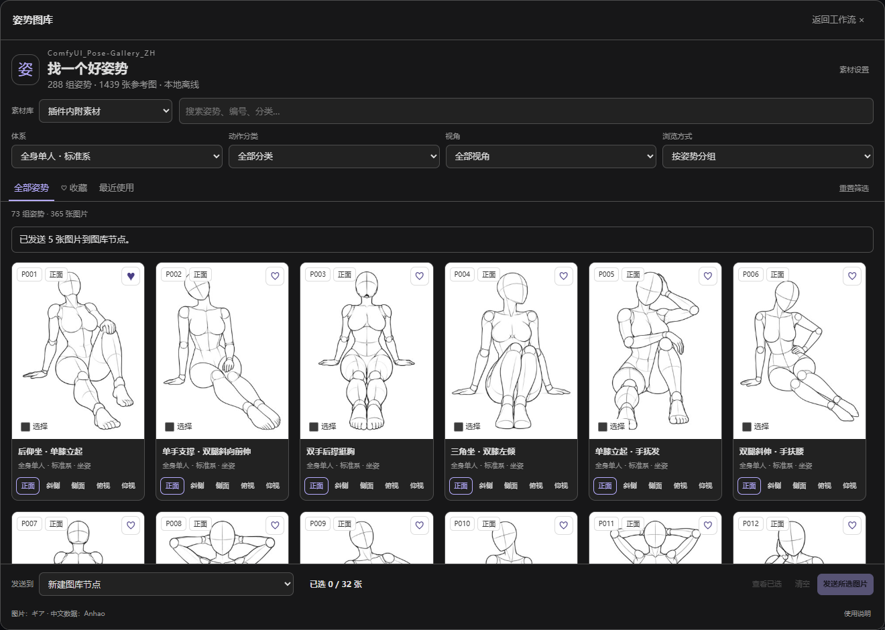

# ComfyUI_Pose-Gallery_ZH

Busque poses, troque de ângulo, escolha a imagem e envie direto para o fluxo, dentro do ComfyUI.

**288 poses · 1.439 imagens de referência · acervo incluído · uso offline · saída única e em lote**



Feito a partir da [galeria de poses em chinês do Anhao](https://github.com/anhao/ai-pose-gallery-zh). Imagens e dados originais de [ギア / giaaibusi](https://x.com/giaaibusi). Esta versão traduz a interface e os dados para o português; o alcance da licença do código e do acervo está no [LICENSE](LICENSE).

## Instalação

Baixe o ZIP deste repositório, extraia, renomeie a pasta para **ComfyUI_Pose-Gallery_ZH** e coloque-a em:

```text
ComfyUI/custom_nodes/ComfyUI_Pose-Gallery_ZH/
├── __init__.py
├── nodes.py
├── js/
├── data/pose-pt.json
├── img/
└── thumbs/
```

Também é possível clonar o repositório dentro de `custom_nodes`:

```bash
git clone https://github.com/Stone-dielianhua/ComfyUI_Pose-Gallery_ZH.git
```

Reinicie o ComfyUI e atualize o navegador. Aparece «Galeria de poses» na barra lateral esquerda, e na busca de nós ficam «Galeria de poses · imagem única» e «Galeria de poses · lote».

O acervo tem cerca de **659,5 MB**, com 1.439 PNG originais e 1.439 miniaturas JPG. Copiar apenas o código deixa as imagens faltando. O plugin usa o Pillow, o NumPy, o PyTorch e o aiohttp que já vêm com o ComfyUI; no uso normal não precisa de npm, dependências extras nem modelos de inferência.

Verificado em: **ComfyUI 0.43.0, frontend 1.57.6, Python 3.12**. Use um frontend moderno, com suporte a barras laterais personalizadas. Em frontends antigos sem a entrada na barra lateral, abra pelo botão «Abrir galeria de poses» do nó; outras versões ainda não foram verificadas na prática.

## Uso

1. Abra «Galeria de poses» na barra lateral, busque por palavras ou número e combine os filtros de série, categoria e ângulo. A busca ignora acentos e maiúsculas.
2. Clique na imagem para abrir a prévia grande e, com o ângulo escolhido, clique em «Usar esta pose». Por padrão é criado um nó de imagem única.
3. Ligue a saída «imagem» do nó em «Pré-visualizar imagem», em salvar imagem ou em outro nó de imagem, e execute.

Se já existir um nó da galeria, escolha-o antes em «Enviar para», no rodapé, ou abra a galeria pelo botão do próprio nó. Trocar a imagem preserva conexões, tamanho e espelhamento. Quando a entrada vem de uma conexão, o aviso pede para desconectá-la ou criar um nó novo.

Clique em «Expandir» para abrir o seletor grande; a seleção da barra lateral vai junto e volta ao fechar. Dá para agrupar por pose ou navegar imagem por imagem, baixar o original e copiar o ID da imagem.

### Lote e múltiplos ângulos

Marque as imagens e clique em «Enviar seleção». Por padrão é criado um nó de lote, que devolve as imagens na ordem da seleção. Em «Ver seleção» você confere e remove imagens.

Na prévia grande dá para escolher todos os ângulos disponíveis de uma pose. O nó de lote também tem o modo «Todos os ângulos da pose», que usa a pose do «ID da imagem». Ordem padrão dos ângulos: Frente → Diagonal → Perfil → De cima → De baixo. Ângulos ausentes ficam desabilitados; no acervo incluído, uma pose não tem o ângulo De baixo.

São no máximo **32 imagens** por lote e **32 milhões** de pixels no total. O lote ajusta com borda para 768×1024 por padrão. No modo de tamanho original, imagens de tamanhos diferentes geram um aviso para trocar o modo de redimensionamento.

### Favoritas e o que fica salvo

- As favoritas são por ângulo; favoritas e recentes ficam neste navegador e não são compartilhadas com o fluxo.
- O fluxo guarda o ID da imagem, o acervo, o tamanho e o espelhamento. Um fluxo que usa o acervo incluído abre a mesma imagem em outro computador com o plugin instalado.
- Fluxos com acervo personalizado exigem que quem receber configure o próprio diretório, mantendo os mesmos IDs.
- `/` foca a busca; na prévia grande, `← / →` troca o ângulo, `↑ / ↓` troca a pose e `Esc` fecha; em telas de toque, deslize para os lados.

## Parâmetros dos nós

| Nó | Saídas |
| --- | --- |
| Galeria de poses · imagem única `PoseGalleryImage` | IMAGE, ID da imagem, descrição da pose |
| Galeria de poses · lote `PoseGalleryBatch` | lote IMAGE, JSON da lista |

Parâmetros comuns:

| Parâmetro | Descrição |
| --- | --- |
| Acervo | Biblioteca interna por padrão; dá para escolher a personalizada já configurada |
| ID da imagem | Preenchido pela galeria; também aceita digitação |
| Tamanho | Tamanho original / Ajustar com borda / Recorte central / Esticar |
| Largura, Altura | Valem fora do tamanho original, de 64 a 4096 |
| Espelhar na horizontal | Espelha a imagem de saída |

«Ajustar com borda» mantém a proporção e preenche o resto de branco; «Recorte central» mantém a proporção e corta o excesso; «Esticar» vai direto ao tamanho pedido. Imagens com transparência são compostas sobre fundo branco. O nó de imagem única usa tamanho original por padrão, e os originais incluídos são 900×1200.

O nó de lote tem ainda «Lista de IDs», «Modo de seleção» e «Ordenação». A lista manual aceita quebras de linha, espaços, vírgulas e ponto e vírgula, e remove repetições. O JSON da lista registra ID, série, número, nome, categoria, ângulo, tamanho de saída e espelhamento, na mesma ordem do lote IMAGE.

## Diretório de acervo

Por padrão são usados os diretórios `data/`, `img/` e `thumbs/` do plugin, **sem depender de nenhum outro diretório da máquina de quem desenvolveu**.

Acervo personalizado: clique em «Configurar acervo» → informe o caminho absoluto → «Verificar e salvar» → escolha «Diretório personalizado» no topo da galeria. No nó, escolha também «Biblioteca personalizada». Antes de salvar são verificadas a estrutura da lista, os IDs e a existência dos originais; uma configuração errada não sobrescreve a que estava funcionando. Para desativar o diretório personalizado, limpe o campo e salve.

O caminho é o do **computador onde o ComfyUI roda**. A configuração fica em `pose_gallery/settings.json`, no diretório de usuário do ComfyUI, e não vai para fluxos compartilhados nem para o código do plugin. Trocar o acervo que você está navegando não altera os nós existentes.

A estrutura de diretórios e um exemplo de JSON estão em [acervo personalizado](docs/custom-assets.md). Nesta primeira versão o acervo personalizado é gerenciado por diretório e lista, o que permite cuidar das imagens pelo gerenciador de arquivos.

## Para controlar a pose gerada

O plugin entrega **imagens de referência**, não extrai esqueleto nem pontos-chave. Ligação típica:

```text
Galeria de poses · imagem única → DWPose / OpenPose → ControlNet de pose → amostragem → decodificação → salvar
```

O pré-processamento de esqueleto exige o [comfyui_controlnet_aux](https://github.com/Fannovel16/comfyui_controlnet_aux), que pode baixar modelos na primeira execução. Gerar com ControlNet pede ainda um modelo base e pesos de ControlNet de pose correspondentes. A detecção em cenas de duas pessoas, com oclusão, dedos ou ângulos incomuns depende do pré-processador, então vale conferir a prévia do esqueleto antes.

## Fluxos de exemplo

Arraste o JSON para dentro do ComfyUI:

| Arquivo | Conteúdo | Requisitos extras |
| --- | --- | --- |
| [01_single_image.json](examples/01_single_image.json) | imagem única → prévia, já testado | nenhum |
| [02_batch_all_angles.json](examples/02_batch_all_angles.json) | todos os ângulos → prévia, saída de 5 imagens testada | nenhum |
| [03_dwpose_preview.json](examples/03_dwpose_preview.json) | referência → DWPose → prévia do esqueleto | controlnet_aux e modelos de pré-processamento |
| [04_controlnet_template.json](examples/04_controlnet_template.json) | DWPose + ControlNet, geração completa | seu modelo base e seu ControlNet |

O quarto é um modelo de **SD1.5, 512×768**; os nomes de modelo são apenas marcadores e precisam ser trocados por modelos compatíveis da sua máquina antes de executar. No terceiro e no quarto as interfaces e ligações foram conferidas, sem executar inferência nem amostragem.

## Dúvidas comuns e desenvolvimento

- A entrada não aparece: confirme que o `__init__.py` está direto na pasta do plugin, sem um nível extra; reinicie o ComfyUI, atualize o navegador e veja o log de carregamento.
- Imagem faltando: confira se o acervo está completo. Rode `python -X utf8 scripts/verify.py`.
- ID inexistente: confira o acervo do nó e a lista correspondente. Um ID inválido não é trocado por outra pose.
- Verificação do back-end: com o Python do ComfyUI, rode `python -m unittest discover -s tests -v`.
- Verificação do front-end: com Node.js 22 ou mais novo, rode `node --test tests/frontend.test.mjs`.

O registro de verificação e o teste no navegador estão em [registro de verificação](docs/testing.md).

## Tradução

A interface, as mensagens, os nós e os dados estão em português. O acervo é descrito em `data/pose-pt.json`, com os campos `id`, `serie`, `numero`, `categoria`, `nome`, `angulo`, `original`, `miniatura` e `busca`. O arquivo `data/translations.csv` guarda o vocabulário completo — japonês original, tradução chinesa e tradução em português — das 4 séries, 26 categorias, 5 ângulos e 288 nomes de pose; `data/pose.json` e `data/meta.json` são os dados japoneses originais. O texto do projeto original continua arquivado em chinês em [docs/ORIGINAL_README.md](docs/ORIGINAL_README.md).

## Publicação no GitHub e licença

O repositório é [Stone-dielianhua/ComfyUI_Pose-Gallery_ZH](https://github.com/Stone-dielianhua/ComfyUI_Pose-Gallery_ZH), com o código do plugin e todo o acervo incluído.

A [solicitação de inclusão no Manager #3445](https://github.com/Comfy-Org/ComfyUI-Manager/pull/3445) já foi enviada; depois do merge e da atualização da lista, dá para buscar por `ComfyUI_Pose-Gallery_ZH` ou `Pose Gallery`. Esta versão ainda não foi publicada no Comfy Registry.

O publicador no Registry é `stone-dielianhua`. Quem mantém o projeto precisa criar uma chave de publicação para esse publicador no [Registry](https://registry.comfy.org/nodes), salvá-la nos [Actions Secrets](https://github.com/Stone-dielianhua/ComfyUI_Pose-Gallery_ZH/settings/secrets/actions) deste repositório com o nome `REGISTRY_ACCESS_TOKEN` e rodar à mão o `Publish to Comfy Registry` em Actions. Antes de cada publicação, atualize a versão no `pyproject.toml`. Não escreva a chave no código nem em conversas.

O alcance da licença de origem é mantido: **o código-fonte usa MIT; as imagens e os dados originais não estão sob o MIT, e o repositório original indica que não podem ser usados comercialmente**. Abrir o código do plugin não muda as restrições do acervo; veja o [LICENSE](LICENSE).

Esta pasta é um projeto de plugin que pode ser instalado e publicado por conta própria; o site estático original pertence ao projeto de origem.
